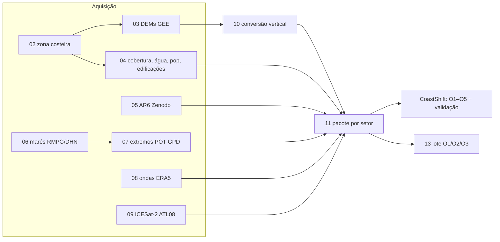

# Métodos — Modelo O2 (estático probabilístico) para a costa do Estado da Bahia

**CoastShift v1.0 · 18/11/2026**
Documento metodológico do modelo recomendado na revisão (Opção 2), com equações, fontes de dados, processamento e validação. As equações têm a mesma numeração usada no código (`coastshift/*.py`, `scripts/*.py`). A seção 8 descreve as demais opções (O1, O3, O4, O5) implementadas no aplicativo.

Rótulos: `[V]` verificado em fonte oficial nesta pesquisa · `[C]` referência consolidada, conferir DOI antes de publicar · `[I]` escolha/hipótese desta metodologia.

---

## 1. Objetivo e pergunta

Estimar, para cada célula de 30 m da zona costeira baiana, a **probabilidade condicional** de ser atingida pela água do mar conectada ao oceano. A estimativa é feita para cada cenário SSP, horizonte (2030–2150) e tipo de nível:

- **permanente:** nível médio do mar (NMM);
- **recorrente:** preamar de sizígia (MHWS) ou preamar superior média (MHHW);
- **episódico:** nível de tempo de retorno T anos.

O resultado também traz a exposição de pessoas, edificações e manguezais, com intervalos.

A probabilidade é **condicional** às hipóteses declaradas: cenário, distribuição AR6, modelo de erro do DEM e conectividade. Não é uma probabilidade absoluta de ocorrência (Fox-Kemper et al., 2021; HTML da revisão §3).

## 2. Área de estudo e unidades de modelagem

A zona costeira é definida como Bahia ∩ distância ao oceano ≤ 15 km ∩ (cota ≤ 25 m ou água), no script 02. A divisão em setores segue o adendo regional (`../01_Adendo_Bahia_Revisao.md`) `[I]`:

| Setor | Trecho | Ambiente | Particularidade usada no modelo |
|---|---|---|---|
| S1 Litoral Norte | Mangue Seco – Itapuã | Praias expostas, dunas, falésias | Setup de ondas ativado |
| S2 Salvador e BTS | Salvador, Recôncavo, Itaparica | Baía com maré amplificada, cidade densa, aterros | Maré interna (Aratu/Madre de Deus); confiança menor no O2 → verificar com O3 |
| S3 Baixo Sul | Valença – Camamu – Maraú | Estuários, manguezais extensos | Erro do DEM sob mangue; habitat (O4) |
| S4 Costa do Cacau | Itacaré – Ilhéus – Canavieiras | Planícies de cordões, fozes | Setup de ondas; subdomínios O3 nas fozes |
| S5 Costa do Descobrimento | Belmonte – Porto Seguro – Cumuruxatiba | Delta, falésias, recifes | Setup reduzido atrás de recifes `[I]` |
| S6 Costa das Baleias | Prado – Caravelas – Mucuri | Planície ampla, Abrolhos | Planície baixa, alta sensibilidade ao erro do DEM |

## 3. Fluxo de processamento

| Script | Ambiente | Entrada | Saída |
|---|---|---|---|
| 01 | Colab/local | — | `config_bahia.json`, pastas |
| 02 | GEE | FAO GAUL, Copernicus DEM (WBM) | zona costeira por setor (GeoJSON) |
| 03 | GEE | Copernicus GLO-30, FABDEM, ANADEM | `dem_<fonte>_<setor>.tif` (EGM2008) |
| 04 | GEE | MapBiomas C10, JRC GSW, GHS-POP, Open Buildings | `landcover/gsw/pop/buildings_<setor>.tif` |
| 05 | Python | AR6 (Zenodo) | `ar6_setores.json` |
| 06 | Python | Série RMPG Salvador, tábuas DHN | `mares_setores.json` |
| 07 | Python | Série RMPG Salvador | `extremos_setores.json` |
| 08 | Python | ERA5 (CDS) | `ondas_setores.json` |
| 09 | Python | ICESat-2 ATL08 (Earthdata) | `atl08_<setor>.csv` |
| 10 | Python | DEMs, EGM2008, hgeoHNOR2020, NMM SGB | `dem_<fonte>_<setor>_nmm.tif` |
| 11 | Python | tudo acima | `pacotes/<setor>/` (entrada do app) |
| 12 | Python | scripts | notebooks Colab |
| 13 | Python | pacotes | resultados em lote |

## 4. Dados e fontes

| Variável | Base (fonte) | Resolução / período | Acesso | Script | Status |
|---|---|---|---|---|---|
| ΔRSL por SSP | IPCC AR6 Sea Level Projections (Garner et al., 2021; Fox-Kemper et al., 2021), doi:10.5281/zenodo.6382554 | Grade 1°; 2020–2150 decenal; quantis | Livre | 05 | `[V]` |
| Terreno (principal) | ANADEM v1 (Laipelt et al., 2024) | 30 m | Livre (tiles/GEE) | 03/10 | `[V]` |
| Terreno (alternativas) | FABDEM V1-2 (Hawker et al., 2022), `projects/sat-io/open-datasets/FABDEM`; Copernicus GLO-30 (`COPERNICUS/DEM/GLO30`) | 30 m; EGM2008 | Livre (FABDEM só para uso não comercial) | 03 | `[V]` |
| Máscara oceânica | Banda WBM do Copernicus DEM | 30 m | Livre | 02/03 | `[C]` |
| Ondulação geoidal | EGM2008 (Pavlis et al., 2012) via PROJ | 2,5′ | Livre | 10 | `[C]` |
| Altitude normal | hgeoHNOR2020 (IBGE, 2021; relatório 2ª ed. 2023) | Grade nacional | Livre | 10 | `[V]` |
| Nível médio, maré e extremos | Marégrafo de Salvador, RMPG/IBGE (série 2004–2024 analisada por Lessa et al., 2026) | Horário | Livre | 06/07 | `[V]` |
| Maré nos demais setores | Tábuas de Marés DHN/CHM; FEMAR | Estações | Livre | 06 | `[C]` |
| Ondas | ERA5 (Hersbach et al., 2020) | 0,5°; 1995–2024 | Livre (conta CDS) | 08 | `[C]` |
| Validação do DEM | ICESat-2 ATL08 (Neuenschwander & Pitts, 2019) | Segmentos de 100 m; 2019–2025 | Livre (Earthdata) | 09 | `[C]` |
| Cobertura e habitats | MapBiomas Coleção 10 (Souza et al., 2020), `projects/mapbiomas-public/assets/brazil/lulc/v1` | 30 m; 1985–2024 | Livre (CC BY 4.0) | 04 | `[V]` |
| Água superficial | JRC GSW v1.4 (Pekel et al., 2016) | 30 m | Livre | 04 | `[C]` |
| População | GHS-POP R2023A, 2025 (JRC); alternativa Censo 2022 (IBGE) | 100 m | Livre | 04 | `[C]` |
| Edificações | Open Buildings 2.5D Temporal (Google) | 4 m → soma em 30 m | Livre | 04 | `[C]` |

## 5. Formulação do modelo O2

### 5.1 Harmonização vertical (script 10)

Todas as alturas são levadas a uma única superfície: o **NMM local na época 2004–2024**, expresso em altitude normal do SGB (REALT-2018, datum Imbituba).

$$h = H_{EGM08} + N_{EGM08} \tag{1}$$

$$H_N = h - \eta_{hgeoHNOR2020} \tag{2}$$

$$z = H_N - \overline{NMM}_{SGB} \tag{3}$$

Onde:
- $H_{EGM08}$ é a altura do DEM;
- $N_{EGM08}$ é a ondulação do geoide EGM2008;
- $\eta$ é o fator de conversão do IBGE. Ele não equivale a uma ondulação geoidal global (IBGE, 2023);
- $\overline{NMM}_{SGB}$ é o nível médio do marégrafo de Salvador em altitude normal, obtido pela ligação RMPG ↔ RN.

Os pontos ICESat-2 (altura elipsoidal $h$) passam por (2)–(3) com os mesmos termos. Assim, DEM e referência são comparados no mesmo datum. Fora de Salvador, usa-se o mesmo $\overline{NMM}_{SGB}$. Essa hipótese ignora a variação da topografia do nível médio ao longo da costa, da ordem de centímetros a decímetros `[I]`. Onde houver estação DHN nivelada ao SGB, ela deve substituir o valor de Salvador.

### 5.2 Projeções do nível relativo do mar (scripts 05; `core.delta_rsl`)

O AR6 fornece, para cada ano $t \in \{2020, \dots, 2150\}$ e quantil $q$, a mudança $Q_t(q)$ relativa a 1995–2014. Adota-se $Q_{2005}(q) = 0$, o centro do período de referência, e interpola-se linearmente no tempo:

$$Q_t(q) = Q_{t_i}(q) + \frac{t - t_i}{t_{i+1} - t_i}\left[Q_{t_{i+1}}(q) - Q_{t_i}(q)\right] \tag{4}$$

Em cada realização $k$ sorteia-se $u_k \sim U(0,1)$. O mesmo $u_k$ é usado em todas as datas da realização (amostragem comonotônica), o que preserva a coerência temporal da trajetória. O valor é obtido por inversão da função quantil:

$$\Delta_{AR6}(t; u_k) = Q_t(u_k) \quad \text{(interpolação linear entre os quantis tabelados)} \tag{5}$$

A mudança relativa à época do NMM local ($t_0 = 2014$, centro de 2004–2024) inclui o VLM residual $v_r$, isto é, o movimento vertical do terreno **não contido** no AR6 (mm/ano, positivo para cima):

$$\Delta RSL(t; u_k) = Q_t(u_k) - Q_{t_0}(u_k) - v_r\,(t - t_0)/1000 \tag{6}$$

O padrão é $v_r = 0$. Só se usa $v_r \neq 0$ quando GNSS (RBMC, SONEL/NGL) ou InSAR indicarem movimento diferente do termo já incluído no AR6. A soma direta de uma taxa InSAR conta duas vezes o ajuste isostático (GIA) e o VLM de fundo (revisão, §2).

### 5.3 Nível de água de referência (scripts 06–08; `core.sea_level_event`)

**Maré** (análise harmônica com UTide, Codiga, 2011):

$$MHWS \approx \overline{NMM} + A_{M2} + A_{S2}, \qquad MHHW = \overline{\max_{dia}\,\zeta(t)} \tag{7}$$

Nos setores sem marégrafo, usa-se a tábua da DHN: $MHWS_{NMM} = MHWS_{NR} - Z_0$. Na BTS, use estações internas, como Aratu e Madre de Deus. Um fator de amplificação $\alpha$ pode escalar a amplitude ($\overline{NMM} + \alpha\,(MHWS - \overline{NMM})$) em testes de sensibilidade.

**Extremos (POT-GPD; script 07).** O ajuste usa a série horária de Salvador, do nível total relativo ao NMM anual (remove a tendência). Os passos:
1. Limiar $u$ no percentil 99.
2. *Declustering* com separação de 72 h.
3. Ajuste da GPD aos excessos ($\sigma$, $\xi$), com taxa $\lambda$ de excessos por ano.

O nível de retorno para $T$ anos é:

$$z_T = u + \frac{\sigma}{\xi}\left[(\lambda T)^{\xi} - 1\right], \qquad \xi \neq 0; \quad z_T = u + \sigma \ln(\lambda T), \; \xi = 0 \tag{8}$$

A distribuição dos máximos anuais (Poisson-GPD), usada no O5, é:

$$F(x) = \exp\left\{-\lambda\left[1 + \xi\,\frac{x-u}{\sigma}\right]^{-1/\xi}\right\} \tag{9}$$

A incerteza dos parâmetros vem de bootstrap ($n = 300$). Em cada realização, $\sigma \sim N(\hat\sigma, se_\sigma)$ e $\xi \sim N(\hat\xi, se_\xi)$.

Para setores sem série longa, $u$ e $\sigma$ são escalados pela razão de MHWS entre o setor e Salvador `[I]`. É uma hipótese simplificadora, a ser conferida com CoDEC/GTSM (Muis et al., 2020).

Hipótese de estacionariedade: no futuro, a distribuição é apenas deslocada por $\Delta RSL$, sem mudança de maré ou de clima de tempestades. Essa hipótese é discutida na revisão, §4E.

**Ondas (apenas costa aberta: S1, S4, S5, S6).** Setup médio de Stockdon et al. (2006):

$$\langle\eta\rangle = 0{,}35\,\beta_f\,\sqrt{H_0 L_0}, \qquad L_0 = \frac{g T_p^2}{2\pi} \tag{10}$$

O cálculo usa $H_0$ igual ao Hs do percentil 99 do ERA5 e o $T_p$ associado. A declividade $\beta_f$ deve vir de perfis, CoastSat ou ICESat-2. Usa-se apenas o *setup*, e não o *runup* de 2%: o *runup* é um processo de espraiamento na face da praia, sem volume para inundar a planície `[I]`.

**Cota d'água da realização $k$:**

$$\eta_k = L_{ref,k} + \Delta RSL(t; u_k) + \langle\eta\rangle\cdot\mathbb{1}_{aberta}$$

com $L_{ref} \in \{\overline{NMM}, MHHW, MHWS, z_T\}$.

### 5.4 Modelo de erro do DEM (script 11; `core.dem_error_maps`, `core.correlated_field`)

A cota verdadeira é modelada como:

$$z_{k}(\mathbf{x}) = z_{DEM}(\mathbf{x}) - b_{c(\mathbf{x})} - s_{c(\mathbf{x})}\,\varepsilon_k(\mathbf{x}) \tag{11}$$

- $b_c$ e $s_c$ são o viés e o desvio-padrão do erro por classe MapBiomas $c$, estimados pelos pontos ICESat-2 (classes com n ≥ 30; senão vale o valor geral);
- $\varepsilon_k$ é um campo gaussiano de média 0 e variância 1, espacialmente correlacionado.

O campo é obtido filtrando ruído branco $w$ com um núcleo gaussiano de escala $\ell$ (em células):

$$\varepsilon_k = \frac{G_\ell * w_k}{\operatorname{sd}(G_\ell * w_k)}, \qquad w_k \sim N(0,1)\;\text{i.i.d.} \tag{12}$$

O padrão é $\ell = 300$ m `[I]`. Recomenda-se estimar $\ell$ pelo variograma dos resíduos ICESat-2 ao longo dos traços. A correlação é essencial: erros independentes por pixel se cancelam na conectividade e subestimam a incerteza (Gesch, 2018; Schmid et al., 2014).

### 5.5 Inundação conectada (`core.connected_flood`)

$$W_k = \{\mathbf{x} : z_k(\mathbf{x}) \le \eta_k\} \cup S \tag{13}$$

$$F_k = \bigcup \{ C \in \mathcal{C}_8(W_k) : C \cap S \neq \emptyset \} \setminus S \tag{14}$$

$S$ é a máscara marinha/estuarina: oceano WBM mais água conectada (GSW ≥ 50% ou classe 33). $\mathcal{C}_8$ são os componentes conectados com vizinhança 8. A vizinhança 4 é oferecida como teste de sensibilidade (Poulter & Halpin, 2008).

Profundidade potencial geométrica:

$$d_k(\mathbf{x}) = \max(0,\, \eta_k - z_k(\mathbf{x}))\cdot \mathbb{1}_{F_k}(\mathbf{x}) \tag{14a}$$

### 5.6 Monte Carlo, probabilidade e exposição (`models.run_o2`)

$$\hat p(\mathbf{x}) = \frac{1}{N}\sum_{k=1}^{N} \mathbb{1}_{F_k}(\mathbf{x}), \qquad se(\hat p) = \sqrt{\hat p(1-\hat p)/N} \tag{14b}$$

$$E_k = \sum_{\mathbf{x}} \mathbb{1}_{F_k}(\mathbf{x})\, e(\mathbf{x}), \quad \bar E = \tfrac{1}{N}\sum_k E_k, \quad [E_{p05}, E_{p95}] \tag{14c}$$

$e(\mathbf{x})$ é a área, a população, as edificações ou a área de mangue da célula. Com $N = 300$, o erro-padrão máximo é 0,029, em $p = 0{,}5$. Para mapas finais use $N \ge 500$ e relate a convergência da área esperada (diferença < 1% entre $N/2$ e $N$) `[I]`.

### 5.7 Configuração de cenários

| Item | Valor | Justificativa |
|---|---|---|
| SSPs | SSP1-2.6, SSP2-4.5, SSP5-8.5 (+ SSP1-1.9 e SSP3-7.0 opcionais) | Cobre a faixa do AR6 |
| Teste de estresse | SSP5-8.5 baixa confiança (`ssp585_lowconf`), p83 | Processos de mantos de gelo de baixa confiança (AR6 Tabela 9.9) |
| Horizontes | 2030, 2050, 2070, 2100, 2150 | Vida útil de planejamento e infraestrutura |
| Níveis | NMM (permanente), MHWS (recorrente), $z_{T}$ para T = 1, 10, 100 anos (episódico) | Não confundir inundação permanente com episódica (revisão §14) |
| N Monte Carlo | 500 | se(p) ≤ 0,022 |
| Semente | Fixa e registrada | Reprodutibilidade |

### 5.8 Parâmetros padrão (editáveis em `params.json`)

| Parâmetro | Padrão | Fonte / observação |
|---|---|---|
| Erro do DEM sem validação | viés 0, dp 1,5 m | Ordem de grandeza dos erros de DEMs globais em costa e vegetação (Hawker et al., 2022; Laipelt et al., 2024) — **substituir pelos valores ICESat-2** |
| $\ell$ (correlação do erro) | 300 m | `[I]`; estimar por variograma |
| Limiar GPD | percentil 99, *declustering* 72 h | Prática usual em POT (Coles, 2001) |
| $\beta_f$ | 0,03–0,05 por setor | `[I]`; medir |
| Conectividade | 8 | Teste com 4 |

### 5.9 Produtos

Por setor × SSP × ano × tipo de nível:
- GeoTIFF de $\hat p$ e de $se(\hat p)$;
- tabela de área, população, edificações e mangue (média, p05, p95);
- área com $\hat p \ge 0{,}5$;
- metadados JSON (parâmetros, versão, semente).

O script 13 consolida a tabela estadual (`resumo_bahia_O2.csv`).

## 6. Validação

A validação é feita por componente, porque nenhuma observação valida sozinha uma projeção futura. Os critérios de aceitação abaixo são **metas indicativas** `[I]` e devem ser declarados antes da execução.

| Componente | Dado independente | Métrica | Meta indicativa |
|---|---|---|---|
| DEM harmonizado | ICESat-2 ATL08 (fora da calibração: separar 30% dos traços), marcos SGB/GNSS | Eqs. 25–26 por classe | Viés residual < 0,2 m após correção; relatar NMAD e LE90 |
| Referencial vertical | Nível do marégrafo vs DEM em áreas de praia/aterro conhecidas | Diferença média | < 0,15 m |
| Maré | Previsão DHN vs série RMPG | Eq. 29 (RMSE, viés) | RMSE < 0,10 m |
| Extremos | Retroteste: ajuste em 2004–2014, teste em 2015–2024 | Eq. 30 (excedências observadas × esperadas) | Dentro do intervalo de Poisson a 90% |
| Mancha de inundação | Preamar de sizígia atual em Sentinel-2 (NDWI) ou Sentinel-1; mapa de inundação de maré de Salvador (Lessa et al., 2026); registros da Defesa Civil | Eqs. 27–28 (CSI, HR, FAR, Brier, confiabilidade) | CSI ≥ 0,6 em costa aberta `[I]`; relatar por setor |
| Conectividade | Inspeção de canais, bueiros e aterros em imagens de alta resolução | Lista de correções | — |
| Comparação de métodos | O2 vs O3 em subdomínios (Salvador, Ilhéus) com mesma topografia e forçante | CSI entre modelos, diferença de área | Decide onde O2 basta |

**Métricas:**

$$\text{viés} = \overline{e},\quad MAE = \overline{|e|},\quad RMSE = \sqrt{\overline{e^2}},\qquad e = z_{DEM} - z_{ref} \tag{25}$$

$$NMAD = 1{,}4826\,\operatorname{med}|e - \operatorname{med}(e)|,\qquad LE90 = P_{90}(|e|) \tag{26}$$

$$CSI = \frac{TP}{TP+FP+FN},\quad HR = \frac{TP}{TP+FN},\quad FAR = \frac{FP}{TP+FP},\quad B = \frac{TP+FP}{TP+FN} \tag{27}$$

$$BS = \frac{1}{M}\sum_{j}(\hat p_j - o_j)^2 \quad \text{+ diagrama de confiabilidade por faixas de } \hat p \tag{28}$$

$$RMSE_{série},\quad NSE = 1 - \frac{\sum (m-o)^2}{\sum (o-\bar o)^2} \tag{29}$$

$$\text{Excedências esperadas de } z_T \text{ em } n \text{ anos} = n/T \;\text{(comparar com as observadas)} \tag{30}$$

**Cuidados.**
- Valide por blocos espaciais (traços ICESat-2 inteiros; setores) e não por pixels aleatórios, que superestimam o desempenho (revisão §6).
- Compare imagens com o horário e o nível da maré no momento da aquisição.
- O ICESat-2 tem viés próprio em vegetação densa e mangue (sinal do terreno fraco). Use o filtro de incerteza (< 1 m) e relate o resultado por classe.

## 7. Sensibilidade e incerteza

1. **Estrutural, DEM:** repetir O2 com ANADEM, FABDEM e Copernicus convertidos. Gerar o mapa de concordância (fração de DEMs com $\hat p \ge 0{,}5$).
2. **Conectividade:** comparar vizinhança 8 e 4 e o mapa não conectado (O1 gera a camada `nao_conectado_extra`).
3. **Maré:** variar $\alpha$ de 0,9 a 1,1 na BTS e testar MHWS vs MHHW.
4. **Extremos:** limiar no percentil 98 e 99,5; com e sem transferência por razão de MHWS.
5. **VLM:** $v_r = \pm 1$ mm/ano como envelope, até haver GNSS ou InSAR.
6. **Decomposição da variância:** rodar O2 isolando cada fonte (só AR6; só DEM; só extremos) e relatar a contribuição de cada uma para a variância da área inundada.

## 8. Demais modelos implementados no aplicativo

| Modelo | Formulação | Equações | Limitações |
|---|---|---|---|
| **O1** bathtub conectado | Eqs. 13–14 com $z = z_{DEM} - b_c$ e $\eta = L_{ref} + \Delta RSL(t; q)$, para um quantil fixo | 13–14a | Sem incerteza nem dinâmica |
| **O3** hidrodinâmica reduzida | Inercial local (Bates et al., 2010) em grade regular | 15–17 | Sem advecção; ondas só como setup; grade agregada |
| **O4** costa e habitats | Bruun + quadro de maré com acreção | 18–21 | Bruun é uma aproximação de equilíbrio, criticada (Cooper & Pilkey, 2004) |
| **O5** integrado | Biblioteca O3 → emulador → máximos anuais → danos | 22–24, 31 | Curva de dano ilustrativa; emulador 1D no nível de pico |

**O3:** continuidade e momento nas faces, com $q$ sendo a vazão por unidade de largura:

$$\frac{\partial h}{\partial t} + \nabla\cdot\mathbf{q} = r \tag{15}$$

$$q^{t+\Delta t} = \frac{q^{t} - g\,h_f\,\Delta t\,\partial\eta/\partial x}{1 + g\,\Delta t\,n^2 |q^{t}| / h_f^{7/3}}, \qquad \Delta t = \alpha_{CFL}\frac{\Delta x}{\sqrt{g\,h_{max}}} \tag{16}$$

- $h_f$ é a profundidade de fluxo na face;
- $n$ é o coeficiente de Manning por classe MapBiomas;
- $\alpha_{CFL} = 0{,}7$.

No contorno marinho, o hidrograma é:

$$\zeta(t) = \overline{NMM}' + A\cos\frac{2\pi(t-t_p)}{T_{M2}} + S\,e^{-\left((t-t_p)/\tau\right)^2} \tag{17}$$

com $A = \alpha(MHWS - \overline{NMM})$, $T_{M2} = 12{,}42$ h e $\tau = 6$ h. O pico é $\zeta(t_p) = \eta$.

**O4:** recuo de equilíbrio (Bruun, 1962), com $h_*$ de Hallermeier (1981) e perfil de Dean (1991):

$$R = \Delta RSL\,\frac{L_*}{h_* + B} \tag{18}$$

$$h_* = 2{,}28\,H_e - 68{,}5\,\frac{H_e^2}{g T_e^2} \tag{19}$$

$$A = 0{,}21\,D_{50}^{0{,}48},\qquad L_* = (h_*/A)^{3/2} \tag{20}$$

O recuo só se aplica a classes arenosas (MapBiomas 23).

Os habitats seguem o quadro de maré, com acreção $a$ em mangue e apicum:

$$z'(t) = z_0 + a\,(t - t_0) - \Delta RSL(t) \tag{21}$$

Classes resultantes:
- mangue potencial: $\overline{NMM} \le z' \le MHWS$;
- apicum: até 0,3 m acima de MHWS;
- submerso: abaixo de NMM;
- afogamento do mangue quando $d\Delta RSL/dt > 7$ mm/ano (Saintilan et al., 2020);
- migração bloqueada em classes urbanas.

**O5:** em $K$ níveis de pico $L_j$, as profundidades máximas $D_j(\mathbf{x})$ do O3 formam a biblioteca. O emulador interpola entre os níveis:

$$\hat D(\mathbf{x}; L) = (1-w)D_{j}(\mathbf{x}) + w D_{j+1}(\mathbf{x}), \qquad w = \frac{L - L_j}{L_{j+1}-L_j} \tag{22}$$

$$\text{Dano}(\mathbf{x}) = V(\mathbf{x})\, f_D\!\left(\hat D(\mathbf{x})\right) \tag{23}$$

$$EAD = \frac{1}{N}\sum_{k=1}^{N} \sum_{\mathbf{x}} \text{Dano}_k(\mathbf{x}), \qquad L_k = x_k^{\max} + \Delta RSL(t;u_k),\; x_k^{\max} \sim F \text{ (Eq. 9)} \tag{24}$$

O emulador é validado automaticamente num nível fora da biblioteca, com RMSE da profundidade e CSI (Eq. 31). A curva $f_D$ padrão é **ilustrativa**: substitua-a pela curva de Huizinga et al. (2017) para a América do Sul e por valores de reposição locais.

**Redistribuição da população (script 11):** pessoas por célula de 100 m são convertidas em densidade e reamostradas para a grade do DEM:

$$P_{30}(\mathbf{x}) = \frac{P_{100}(\mathbf{x}')}{A_{100}}\,A_{30} \tag{32}$$

## 9. Limitações

- O O2 representa um **equilíbrio estático**. Na BTS e nos estuários do Baixo Sul, onde a maré se amplifica, se atrasa e é amortecida, valide com O3/O4 antes de usar resultados locais.
- O erro dos DEMs globais (metros) pode superar o $\Delta RSL$ de 2050 (decímetros). O resultado é informativo como **probabilidade**, não como linha determinística.
- Estruturas de drenagem, comportas e aterros não aparecem em DEMs de 30 m. Corrija a conectividade localmente.
- A transferência dos extremos de Salvador para outros setores é uma hipótese. A série de 21 anos limita os tempos de retorno acima de ~50 anos.
- Cenários futuros de ocupação (SSP populacional) não estão incluídos na exposição padrão (use D30 da revisão).
- Não há modelagem de erosão no O2 (ver O4).

## 10. Reprodutibilidade

- **Versões:** registre o pacote AR6 (versão Zenodo), a coleção MapBiomas, a versão do ANADEM/FABDEM, o arquivo hgeoHNOR2020 e o commit do CoastShift.
- **Semente:** registre a semente Monte Carlo. Ela vai para o `metadados.json` exportado.
- **Código:** GPL-3.0, em https://github.com/rnvuefsppgm/CoastShift.
- **Licença dos dados:** FABDEM é CC BY-NC-SA. Não use comercialmente nem redistribua sem respeitar a licença.

## 11. Referências

- Bates, P. D., Horritt, M. S., & Fewtrell, T. J. (2010). A simple inertial formulation of the shallow water equations for efficient two-dimensional flood inundation modelling. *Journal of Hydrology, 387*, 33–45. https://doi.org/10.1016/j.jhydrol.2010.03.027 `[V]`
- Bruun, P. (1962). Sea-level rise as a cause of shore erosion. *Journal of the Waterways and Harbors Division, 88*(1), 117–130. `[C]`
- Codiga, D. L. (2011). *Unified tidal analysis and prediction using the UTide Matlab functions* (GSO Technical Report 2011-01). University of Rhode Island. `[C]`
- Coles, S. (2001). *An introduction to statistical modeling of extreme values*. Springer. https://doi.org/10.1007/978-1-4471-3675-0 `[C]`
- Cooper, J. A. G., & Pilkey, O. H. (2004). Sea-level rise and shoreline retreat: Time to abandon the Bruun Rule. *Global and Planetary Change, 43*, 157–171. https://doi.org/10.1016/j.gloplacha.2004.07.001 `[C]`
- Dean, R. G. (1991). Equilibrium beach profiles: Characteristics and applications. *Journal of Coastal Research, 7*(1), 53–84. `[C]`
- Fox-Kemper, B., et al. (2021). Ocean, cryosphere and sea level change. In *Climate Change 2021: The Physical Science Basis* (cap. 9). Cambridge University Press. https://doi.org/10.1017/9781009157896.011 `[V]`
- Garner, G. G., et al. (2021). *IPCC AR6 Sea Level Projections* [dados]. Zenodo. https://doi.org/10.5281/zenodo.6382554 `[V]`
- Gesch, D. B. (2018). Best practices for elevation-based assessments of sea-level rise and coastal flooding exposure. *Frontiers in Earth Science, 6*, 230. https://doi.org/10.3389/feart.2018.00230 `[V]`
- Hallermeier, R. J. (1981). A profile zonation for seasonal sand beaches from wave climate. *Coastal Engineering, 4*, 253–277. https://doi.org/10.1016/0378-3839(80)90022-8 `[C]`
- Hawker, L., et al. (2022). A 30 m global map of elevation with forests and buildings removed. *Environmental Research Letters, 17*, 024016. https://doi.org/10.1088/1748-9326/ac4d4f `[V]`
- Hersbach, H., et al. (2020). The ERA5 global reanalysis. *Quarterly Journal of the Royal Meteorological Society, 146*, 1999–2049. https://doi.org/10.1002/qj.3803 `[C]`
- Huizinga, J., de Moel, H., & Szewczyk, W. (2017). *Global flood depth-damage functions* (JRC Technical Report EUR 28552 EN). Publications Office of the EU. https://doi.org/10.2760/16510 `[C]`
- IBGE. (2023). *hgeoHNOR2020: modelo para conversão de altitudes geométricas em altitudes normais* (2ª ed.). https://biblioteca.ibge.gov.br/visualizacao/livros/liv102048.pdf `[V]`
- Laipelt, L., et al. (2024). ANADEM: A digital terrain model for South America. *Remote Sensing, 16*(13), 2321. https://doi.org/10.3390/rs16132321 `[V]`
- Lessa, G. C., et al. (2026). *The variability of sea level and its impact on coastal flooding in Baía de Todos os Santos (13°S)* [preprint]. SciELO Preprints. https://doi.org/10.1590/2675-2824074.250232 `[V]`
- Muis, S., et al. (2020). A high-resolution global dataset of extreme sea levels, tides, and storm surges, including future projections. *Frontiers in Marine Science, 7*, 263. https://doi.org/10.3389/fmars.2020.00263 `[C]`
- Neuenschwander, A., & Pitts, K. (2019). The ATL08 land and vegetation product for the ICESat-2 mission. *Remote Sensing of Environment, 221*, 247–259. https://doi.org/10.1016/j.rse.2018.11.005 `[C]`
- Pavlis, N. K., Holmes, S. A., Kenyon, S. C., & Factor, J. K. (2012). The development and evaluation of the Earth Gravitational Model 2008 (EGM2008). *Journal of Geophysical Research, 117*, B04406. https://doi.org/10.1029/2011JB008916 `[C]`
- Pekel, J.-F., Cottam, A., Gorelick, N., & Belward, A. S. (2016). High-resolution mapping of global surface water and its long-term changes. *Nature, 540*, 418–422. https://doi.org/10.1038/nature20584 `[C]`
- Poulter, B., & Halpin, P. N. (2008). Raster modelling of coastal flooding from sea-level rise. *International Journal of Geographical Information Science, 22*(2), 167–182. https://doi.org/10.1080/13658810701371858 `[V]`
- Saintilan, N., et al. (2020). Thresholds of mangrove survival under rapid sea level rise. *Science, 368*, 1118–1121. https://doi.org/10.1126/science.aba2656 `[C]`
- Schmid, K., Hadley, B., & Waters, K. (2014). Mapping and portraying inundation uncertainty of bathtub-type models. *Journal of Coastal Research, 30*(3), 548–561. https://doi.org/10.2112/JCOASTRES-D-13-00118.1 `[C]`
- Souza, C. M., Jr., et al. (2020). Reconstructing three decades of land use and land cover changes in Brazilian biomes with Landsat archive and Earth Engine. *Remote Sensing, 12*(17), 2735. https://doi.org/10.3390/rs12172735 `[C]`
- Stockdon, H. F., Holman, R. A., Howd, P. A., & Sallenger, A. H. (2006). Empirical parameterization of setup, swash, and runup. *Coastal Engineering, 53*, 573–588. https://doi.org/10.1016/j.coastaleng.2005.12.005 `[C]`
