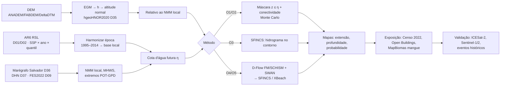
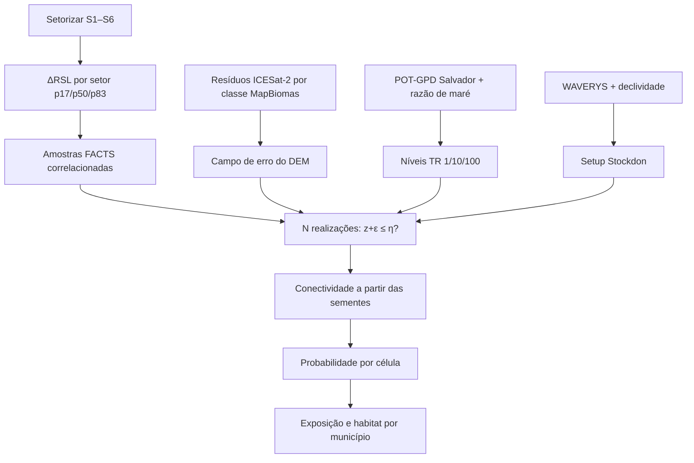
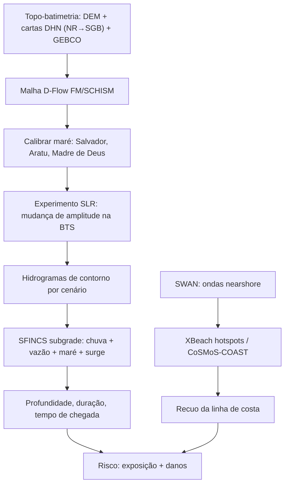

# Cinco opções de modelagem para a costa da Bahia — ferramental e acesso às bases

Responde ao pedido final e instancia para a Bahia os **Produtos 6 (fluxogramas) e 7 (recomendações)**. As três abordagens genéricas do HTML (§7) foram desdobradas em **cinco níveis** de complexidade. Bases citadas por ID (D01–D57: planilha + `02_Inventario_Bases_Bahia.md`); modelos por ID (M01–M18 na planilha; M19+ na seção 7 deste arquivo). Estimativas de custo, tempo e hardware são **julgamentos desta revisão** `[I]`, para um analista experiente.

---

## 1. Visão comparativa

| ID | Opção | Pergunta que responde | Processos representados | Ferramental principal | Bases-chave | Resolução típica | Hardware | Tempo estimado | Reprodutibilidade | Indicada para |
|---|---|---|---|---|---|---|---|---|---|---|
| O1 | Triagem estática conectada (bathtub hidraulicamente conectado) | Que áreas ficam abaixo do NMM/preamar futuros e ligadas ao mar? | Nível médio + maré (estático), conectividade | GEE ou Python (rasterio, scipy) / QGIS-GRASS `r.lake`; M02 | D01/D02, D33, D14, D37, D35, D45, D39 | 30 m (estado) | Notebook comum / GEE | 3–6 semanas | Alta (dados abertos) | Diagnóstico estadual inicial; S1, S4–S6 |
| O2 | Estático probabilístico com extremos, VLM e incerteza de DEM | Qual a **probabilidade** de uma célula ser atingida por preamar/evento de 1–100 anos em cada SSP? | O1 + extremos (POT-GPD), runup empírico, VLM, erro do DEM (Monte Carlo) | Python (xarray, pyextremes), FACTS/AR6 amostras (M01), M12, M24; GEE | O1 + D36, D08, D48, D51, D49/D50, D52 | 30 m | Estação de trabalho (32–64 GB RAM) | 2–4 meses | Alta | **Produto estadual de referência** para planejamento |
| O3 | Hidrodinâmica reduzida em setores prioritários (inundação composta) | Qual a profundidade, extensão e duração da inundação em eventos futuros em fozes e cidades? | Propagação 2D (inercial/subgrade), maré, surge, chuva, vazão, ondas parametrizadas | SFINCS (M03) + HydroMT-SFINCS (M19); LISFLOOD-FP (M04) alternativo | O2 + D38, D15, D09, D08, D07, D31, D43/D42 | 5–25 m (subgrade 1–5 m) | Workstation multicore / GPU opcional | 3–6 meses por setor | Média-alta | Salvador (margens da BTS), Ilhéus, Canavieiras, Caravelas, Valença |
| O4 | Hidrodinâmica regional + ondas + morfologia e habitats | Como maré, ondas e sedimentos mudam o nível, a linha de costa e os manguezais da BTS/Baixo Sul? | Circulação 2D/3D, ondas espectrais, transporte, erosão de evento, evolução de linha de costa, migração de mangue | Delft3D FM/D-Flow FM + D-Waves/SWAN (M06) ou SCHISM-WWM (M20); XBeach (M08); CoSMoS-COAST (M09) ou ShorelineS (M21); MEM/tidal-frame (M23) | O3 + D48, D44, D55, CoastSat (M16), D45, D46 | Malha 20–500 m; XBeach 2–10 m | Cluster/HPC ou nuvem | 6–12 meses | Média | BTS, Camamu–Maraú, hotspots de erosão (Salvador, Vera Cruz, Ilhéus, Porto Seguro) |
| O5 | Sistema integrado probabilístico acoplado (tipo CoSMoS) com emulador | Distribuição de risco (perdas, pessoas, habitat) por SSP × horizonte em toda a costa | Downscaling oceânico e de ondas CMIP6 + FACTS + O3/O4 + exposição/danos + emulador ML | ROMS/CROCO (M07/M27) ou D-Flow FM; WW3 (M28); FACTS (M01); SFINCS; emulador (M13); funções de dano | Todas + CMIP6 (ESGF) | Multiescala | HPC (centenas de núcleos) | 2–4 anos (programa de pesquisa) | Média (depende de publicação de configurações) | Programa estadual/rede de pesquisa |

**Regra de escolha** `[I]`: suba de nível apenas quando a pergunta exigir uma grandeza que o nível anterior não produz (probabilidade → O2; profundidade/duração → O3; morfologia/ondas/habitats → O4; risco integrado com incerteza completa → O5) **e** houver dados para calibrar/validar o processo adicionado (HTML §8; Cotrim et al., 2026).

---

## 2. Opção 1 — Triagem estática conectada

**Objetivo.** Mapear, para toda a costa, áreas potencialmente submersas permanentemente (NMM futuro) e inundadas periodicamente (MHWS futura), por SSP e horizonte.

**Variáveis.** Obrigatórias: DEM de terreno; ΔRSL (AR6); NMM local e preamar no mesmo datum; máscara de mar/estuário (sementes). Opcionais: diques/aterros, população, uso do solo.

**Ferramental e acesso.**
- **Google Earth Engine** (gratuito para pesquisa): ANADEM (asset GEE), FABDEM (comunidade GEE), Copernicus GLO-30, MapBiomas, JRC GSW, Open Buildings — evita download.
- **Python**: `xarray`/`netCDF4` (AR6), `rasterio`, `numpy`, `scipy.ndimage.label` (conectividade), `geopandas`. Alternativa: **QGIS + GRASS** (`r.lake` com semente; `r.mapcalc`).
- AR6: baixar do Zenodo (D01) ou ler pontos na NASA Tool (D02).

**Passos.**
1. Extrair ΔRSL (p17/p50/p83) por setor S1–S6 para 2030–2150 (snippet na seção 8).
2. Converter DEM → altura elipsoidal → altitude normal SGB (D35) → relativo ao NMM local (D36/D37).
3. Definir cota d'água: η = NMM + ΔRSL (permanente) e η = MHWS + ΔRSL (recorrente), por setor.
4. Máscara z ≤ η; rotular componentes conectados (8-vizinhos e 4-vizinhos, reportar ambos) a partir das sementes oceânicas.
5. Cruzar com população (D39/D40) e habitats (D45).

**Produtos.** GeoTIFF/COG de extensão conectada e profundidade geométrica por cenário; tabelas de área, população e mangue por município e setor; mapa de diferença conectado × não conectado.

**Validação mínima.** ICESat-2 (D51) e marcos SGB para erro vertical do DEM; comparação com o mapa de inundação de maré atual de Salvador (Lessa et al., 2026) e imagens Sentinel-2 de preamar de sizígia.

**Limitações.** Sem dinâmica (superestima em baías com amortecimento e subestima onde há amplificação); erro do DEM pode ser maior que o próprio ΔRSL de 2050; não representa erosão.

---

## 3. Opção 2 — Estático probabilístico (extremos + VLM + erro de DEM)

**Objetivo.** Probabilidade condicional de inundação por célula para níveis recorrentes e eventos (TR 1, 10, 100 anos), incorporando as principais incertezas.

**Acrescenta a O1:**
- **Extremos:** POT-GPD na série de Salvador (D36) com *declustering*; transferir para outros setores pela razão de amplitudes de maré (FES2022/DHN) e surge GTSM (D08), com correção de viés `[I]`. Bibliotecas: `pyextremes` (Python) ou `extRemes` (R) (M25).
- **Ondas:** em costa aberta, somar setup (≈ fração do runup de Stockdon et al., 2006; M24) com ondas WAVERYS/ERA5 (D48/D07) propagadas por declividade de praia (de CoastSat/ICESat-2). Usar setup (não runup total) para inundação de planície `[I]`.
- **VLM:** comparar o termo de VLM do AR6 com GNSS (D49/D50); se houver evidência, InSAR (D52) em Salvador e Ilhéus. Só adicionar o residual não contido no AR6 (HTML §2).
- **Incerteza do DEM:** campo de erro espacialmente correlacionado (variograma dos resíduos ICESat-2 por classe de cobertura MapBiomas) + escolha de DEM (ANADEM/FABDEM/DeltaDTM) como incerteza estrutural.
- **Monte Carlo:** N ≥ 500 realizações por SSP×horizonte, amostrando conjuntamente ΔRSL (amostras FACTS preservam correlação temporal), erro vertical, nível extremo e conectividade → frequência de células molhadas = probabilidade condicional.
- **Habitat simples:** regra de quadro de maré para manguezal (faixa entre ~NMM e MHWS) com acreção como parâmetro (0–10 mm/ano, sensibilidade) e barreiras urbanas do MapBiomas → espaço de acomodação `[I]`.

**Produtos.** Mapas de probabilidade (0–1), mapas de "acordo entre DEMs", área/população exposta com intervalos, curvas de excedência por município, perda/ganho potencial de mangue por SSP.

**Validação.** Erro vertical estratificado; cobertura de intervalos dos extremos (retroteste com 2004–2014 → 2015–2024); eventos documentados de frentes frias (Dutra et al.) e registros da Defesa Civil de Salvador.

**Por que é a opção-base recomendada para a Bahia:** a maré e os extremos moderados tornam a abordagem estática probabilística fisicamente razoável em grande parte do litoral aberto, com custo baixo e alta reprodutibilidade `[I]`.

---

## 4. Opção 3 — Hidrodinâmica reduzida (SFINCS) em setores prioritários

**Objetivo.** Profundidade máxima, duração, tempo de chegada e extensão para eventos compostos atuais e futuros em áreas onde O1/O2 são inadequadas (margens da BTS, fozes urbanas).

**Ferramental e acesso.** **SFINCS** (Deltares, código aberto, GitHub `Deltares/SFINCS`; executável e Docker) + **HydroMT-SFINCS** (Python, monta o modelo a partir de DEM, rugosidade por uso do solo, contornos de maré/surge e rios). Alternativa: **LISFLOOD-FP 8** (M04, aberto). Pós-processamento: `xarray`, `rioxarray`, QGIS.

**Configuração.**
1. Topo-batimetria fundida: DEM harmonizado + cartas DHN (D38) digitalizadas e convertidas do NR + GEBCO externo.
2. Subgrade (1–5 m onde houver LiDAR/D43; senão 30 m) com malha computacional 10–50 m.
3. Rugosidade de Manning por classe MapBiomas.
4. Contorno: série de nível = maré (FES2022 calibrada com D36/D37) + surge (GTSM/D08 ou modelo de frente fria) + ΔRSL; ondas como setup/forçante pontual.
5. Chuva (ERA5/INMET/MERGE) e vazões (HidroWeb D31) para eventos compostos.
6. Eventos sintéticos: combinações frente fria × sizígia por cópulas ou amostragem histórica com ΔRSL somado `[I]`.

**Calibração/validação.** Maré em Salvador e Aratu (amplitude/fase; RMSE < 10 cm como meta indicativa `[I]`); eventos históricos: manchas de inundação em Sentinel-1 (D52) e registros municipais; CSI/IoU, erro de pico e de tempo (HTML §6).

**Produtos.** Rasters de profundidade máxima e duração por evento/cenário; hidrogramas em pontos críticos (Comércio, Calçada, Ribeira, Ilhéus-Pontal, Caravelas); camadas de exposição dinâmica.

**Limitações.** Física reduzida (sem advecção forte; ondas parametrizadas); depende fortemente da topografia urbana e da drenagem — sem LiDAR, a vantagem sobre O2 pode ser pequena (Cotrim et al., 2026).

---

## 5. Opção 4 — Regional hidrodinâmica + ondas + morfologia + habitats

**Objetivo.** Representar processos que mudam o próprio nível e a forma da costa: amplificação de maré e circulação da BTS/Camamu sob SLR, propagação de ondas, erosão de eventos, recuo de longo prazo e migração de manguezais.

**Ferramental e acesso.**
- **Delft3D FM Suite** (D-Flow FM + D-Waves/SWAN + D-Morphology; Deltares; núcleo aberto, GUI comercial) **ou** **SCHISM + WWM** (aberto) — malha não estruturada da plataforma ao estuário.
- **SWAN** (TU Delft, aberto) para ondas nearshore com contorno WAVERYS/ERA5.
- **XBeach** (aberto) para erosão/galgamento em hotspots (perfis 1D ou 2D).
- **CoSMoS-COAST** (USGS) ou **ShorelineS** (aberto, MATLAB) para linha de costa decenal; **CoastSat** + **DSAS** (M16, M26) para histórico.
- **Habitat:** MEM/tidal-frame (M23) ou SLAMM (M10) adaptado a manguezal; Hydro-MEM se houver dados de acreção.
- Pré/pós: Python (`xugrid`, `dfm_tools`), MATLAB/Octave, QGIS.

**Passos-chave.** (1) Malha + batimetria DHN; (2) calibração de maré (constituintes M2, S2, N2, K1, O1) em várias estações; (3) experimento de sensibilidade: maré com NMM atual vs +0,5/+1,0 m para quantificar mudança de amplitude dentro da BTS; (4) clima de ondas e transporte longitudinal coerente com Bittencourt et al. (2000); (5) linha de costa calibrada com CoastSat 1984–2025 e validada em bloco temporal independente; (6) mangue: acreção medida/literatura + espaço de migração.

**Produtos.** Mudança de amplitude de maré por SLR; mapas de inundação dinâmica; envoltórias de recuo da linha de costa (p17–p83) por SSP; mapas de habitat futuro.

**Limitações.** Dados de sedimento, acreção e batimetria recente são escassos; incerteza paramétrica alta na morfologia; custo de calibração.

---

## 6. Opção 5 — Sistema integrado probabilístico acoplado

**Objetivo.** Programa de pesquisa para risco costeiro estadual com incerteza completa: clima → oceano → ondas → inundação → morfologia → habitats → exposição/perdas, em conjunto de cenários grande.

**Componentes.** FACTS (M01) para ΔRSL probabilístico; downscaling oceânico (ROMS/CROCO como em Toste et al., 2024) forçado por CMIP6 (ESGF) para mudanças de nível dinâmico regional e de maré; ondas futuras com WAVEWATCH III/SWAN forçado por ventos CMIP6; biblioteca de simulações O3/O4; **emulador ML** (M13; ex.: HyFlood, Ricondo et al., 2026; redes neurais de Gharehtoragh & Johnson, 2024) para amostrar milhares de eventos; funções de dano e exposição futura por SSP (D30).

**Requisitos.** HPC, equipe multidisciplinar, LiDAR costeiro, rede de monitoramento (marégrafos adicionais, GNSS, perfis de praia).

**Validação.** Do simulador contra observações e do emulador contra simulações não usadas no treino, fora da faixa de treino (HTML §4F e §6).

---

## 7. Ferramental adicional (Produto 4 — extensão; IDs M19+)

| ID | Ferramenta | Tipo | Licença/código | Linguagem | Documentação | Uso nas opções | Status |
|---|---|---|---|---|---|---|---|
| M19 | HydroMT / HydroMT-SFINCS | Construtor de modelos a partir de dados globais | Aberto (MIT) | Python | https://deltares.github.io/hydromt/ ; Eilander et al. (2023, JOSS) | O3–O5 | [C] |
| M20 | SCHISM (+WWM-III) | Hidrodinâmica 3D malha não estruturada + ondas | Aberto (Apache) | Fortran | https://schism-dev.github.io/schism/ ; Zhang et al. (2016) | O4–O5 | [C] |
| M21 | ShorelineS | Linha de costa de forma livre (one-line) | Aberto | MATLAB | Roelvink et al. (2020) | O4 | [C] |
| M22 | Regra de Bruun / modelos de equilíbrio (Yates, ShoreFor) | Resposta transversal | Fórmulas abertas | Qualquer | Bruun (1962); Yates et al. (2009); Davidson et al. (2013); crítica: Cooper & Pilkey (2004), Ranasinghe et al. (2012) | O2 (sensibilidade), O4 | [C] |
| M23 | MEM / modelos de quadro de maré para mangue/marisma; Hydro-MEM | Ecogeomorfologia | Abertos (variam) | R/Python/MATLAB | Morris et al. (2002); Alizad et al. (2016) | O2 (regra simples), O4 | [C] |
| M24 | Parametrização de runup/setup (Stockdon) | Empírico | Aberto | Qualquer | Stockdon et al. (2006) | O2–O3 | [C] |
| M25 | pyextremes / extRemes | Estatística de extremos (GEV, POT) | Aberto | Python / R | Gilleland & Katz (2016) para extRemes | O2–O5 | [C] |
| M26 | DSAS v5/v6 | Taxas de mudança de linha de costa por transectos | Aberto (USGS) | ArcGIS add-in / Python (v6) | Himmelstoss et al. (2018) | O4 | [C] |
| M27 | CROCO | Oceano regional (sucessor ROMS-AGRIF) | Aberto (CeCILL) | Fortran | https://www.croco-ocean.org | O5 | [C] |
| M28 | WAVEWATCH III | Ondas espectrais globais/regionais | Aberto | Fortran | NOAA/NCEP (WW3DG) | O5 | [C] |
| M29 | Google Earth Engine | Plataforma de processamento em nuvem | Gratuito p/ pesquisa (código fechado) | JS/Python | Gorelick et al. (2017) | O1–O2 | [C] |

---

## 8. Fluxogramas (Produto 6 — Bahia)

### 8.1 Cadeia comum: da projeção ao mapa



### 8.2 O1 → O2 (triagem estadual)



### 8.3 O3/O4 (setores prioritários)



---

## 9. Recomendação para a Bahia (Produto 7 — regional) `[I]`

| Ordem | Ação | Justificativa |
|---|---|---|
| 1 | **O2 em toda a costa** (com O1 como etapa intermediária) | Maré dominante e extremos moderados tornam a abordagem estática probabilística defensável; cobre 100% do litoral; alta reprodutibilidade |
| 2 | **O3 em Salvador–BTS e nas fozes urbanas** (Ilhéus, Canavieiras, Caravelas, Valença) | Onde O2 é fisicamente fraca (amortecimento/amplificação de maré, drenagem, chuva) e há exposição alta |
| 3 | **O4 na BTS e Camamu–Maraú + hotspots de erosão** | Mudança de maré com SLR, manguezais extensos e erosão documentada |
| 4 | **O5 como programa de pesquisa** | Só após LiDAR, monitoramento e configurações publicadas de O3/O4 |

**Escala:** estadual → O2; regional (baía/estuário) → O4 com O3 aninhado; local/municipal (ativo, bairro) → O3 com LiDAR, ou O4 onde ondas/morfologia mudam a decisão. Consistente com a ordem por escala do HTML §8.

**Teste pareado obrigatório:** em pelo menos um trecho de S2 e um de S4, comparar O2 × O3 com mesma topografia e forçante; publicar o CSI e a diferença de área. Isso decide, com evidência local, onde O2 basta (HTML §8; Cotrim et al., 2026).

---

## 10. Esboços de código (O1/O2)

### 10.1 Extrair ΔRSL do AR6 por ponto (Python)

```python
# Arquivos regionais do AR6 (Zenodo, D01). Nome/estrutura exatos: conferir no pacote baixado [NV].
import xarray as xr, numpy as np
f = "ar6-regional-confidence/regional/confidence_output_files/medium_confidence/ssp245/total_ssp245_medium_confidence_values.nc"
ds = xr.open_dataset(f)                       # dims: quantiles, years, locations ; unidade: mm
lat, lon = ds["lat"].values, ds["lon"].values
setores = {"S2_Salvador": (-13.0, -38.5), "S4_Ilheus": (-14.8, -39.0), "S6_Caravelas": (-17.7, -39.2)}
for nome, (la, lo) in setores.items():
    i = int(np.argmin((lat - la) ** 2 + (lon - lo) ** 2))  # escolher só pontos oceânicos/costeiros
    s = ds["sea_level_change"].isel(locations=i).sel(quantiles=[0.17, 0.5, 0.83], years=[2050, 2100])
    print(nome, float(lat[i]), float(lon[i]), (s / 1000).round(2).values)  # metros, rel. 1995–2014
```

### 10.2 Bathtub conectado com Monte Carlo (Python)

```python
import numpy as np, rasterio
from scipy import ndimage

def inundacao_conectada(z, eta, mar, conn=8):
    """z: DEM relativo ao NMM local (m); eta: cota d'água (m); mar: bool das sementes oceânicas."""
    molhado = (z <= eta) | mar
    est = np.ones((3, 3)) if conn == 8 else ndimage.generate_binary_structure(2, 1)
    rot, _ = ndimage.label(molhado, structure=est)
    ids = np.unique(rot[mar & (rot > 0)])
    return np.isin(rot, ids) & ~mar

with rasterio.open("dem_nmm_local.tif") as src:          # já convertido: EGM→h→SGB→NMM local
    z, perfil = src.read(1).astype("float32"), src.profile
mar = rasterio.open("sementes_mar.tif").read(1).astype(bool)

rng, N = np.random.default_rng(42), 500
amostras_rsl = np.load("rsl_S2_ssp245_2100.npy")        # amostras FACTS do setor (m)
mhws, sigma_dem = 1.30, 1.5                             # MHWS sobre NMM (m) e erro DEM (m): valores ILUSTRATIVOS
freq = np.zeros_like(z)
for k in range(N):
    erro = rng.normal(0, sigma_dem)                     # substituir por campo correlacionado por classe de cobertura
    eta = mhws + rng.choice(amostras_rsl)
    freq += inundacao_conectada(z + erro, eta, mar)
perfil.update(dtype="float32", nodata=-1)
with rasterio.open("prob_inund_S2_ssp245_2100.tif", "w", **perfil) as dst:
    dst.write(freq / N, 1)
```

*Notas:* um viés uniforme por realização, como no esboço, é o caso mais simples; o recomendado é um campo de erro espacialmente correlacionado, estratificado por cobertura (HTML §6). Processar o estado em blocos (tiles) com sobreposição para não cortar conectividade nas bordas.
